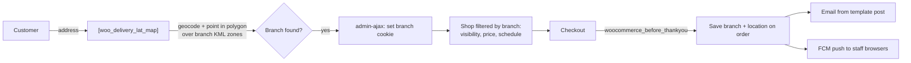

# Woo Delivery Lat

WordPress / WooCommerce plugin for restaurants with several branches. The
customer types an address, the plugin finds which branch covers it (using
coverage polygons drawn in Google My Maps), and the shop then shows only
the products, prices and opening hours of that branch. When the order is
placed, the branch gets an email and a browser push notification.

Built in 2021 at [Machinesoft](https://machinesoft.tech), my software company, for a restaurant chain in Colombia, so the UI strings are in Spanish.

## Features

- **Branch offices**: name, phone, address, geocoded location and a **KML
  coverage zone** uploaded from [Google My Maps](https://www.google.com/maps/d/).
  The admin page previews the zone and the pin on a map.
- **Schedules**: reusable opening hours per weekday,
  assigned to branches and optionally to single products.
- **Per-branch catalog**: each product can be limited to some branches, with
  a price override and stock amount per branch (new **Woo Delivery** tab in
  the product editor).
- **Delivery or pickup**:
  - `[woo_delivery_lat_map page="/shop"]`: address search over the
    coverage polygons (point-in-polygon), then a modal sends the customer
    to the shop of the branch that covers that address.
  - `[woo_delivery_lat_store_list page="/shop"]`: list of the branches open now,
    for store pickup.
- **Order notifications**:
  - Email built from a regular WordPress post used as a template, with
    placeholders `##officeName`, `##addressDestination`,
    `##urlGoogleDestination` (Google Maps link to the delivery point) and
    `##urlOrden` (link to the order in wp-admin).
  - Browser push to staff (Firebase Cloud Messaging + service worker).

## Screenshots

> _Coming soon: branch editor with KML coverage, address search map, product branch tab._

## How it works

WordPress hooks used:

| Hook | Purpose |
|---|---|
| `woocommerce_product_is_visible` | Hide products not sold by the selected branch or outside its schedule |
| `woocommerce_product_variation_get_price`, `woocommerce_variation_prices_*`, `woocommerce_cart_item_price`, `woocommerce_before_calculate_totals` | Per-branch price override |
| `woocommerce_product_data_tabs` / `woocommerce_product_data_panels` / `save_post_product` | "Woo Delivery" product tab and its meta |
| `woocommerce_before_shop_loop` | Banner with the selected branch and address |
| `woocommerce_before_thankyou` | Attach branch and location to the order, send notifications |
| `wp_ajax_*` / `wp_ajax_nopriv_*` | KML upload (admin), branch cookie, push token registration |
| `admin_menu`, `plugins_loaded`, activation hook | Admin pages and schema install/upgrade via `dbDelta` |

Data lives in four tables (`{prefix}wdlat_branch_offices`,
`wdlat_schedules`, `wdlat_schedules_details`, `wdlat_branch_schedule`) plus
product meta `offices`.

Theme extension points: `woo_del_lat_before_form_map`,
`woo_del_lat_before_modal_confirm_store`, `woo_del_lat_header_store_detail`,
`woo_del_lat_footer_store_detail`.

## Installation

1. Copy this repository into `wp-content/plugins/woo-delivery-lat`.
2. Activate **Woo Delivery Lat** (WooCommerce must be active).
3. Open **Woo Delivery Lat → Configuración**.

## Configuration

| Setting | Used for |
|---|---|
| Google Maps API key | Maps, geocoding and KML rendering (restrict it by HTTP referrer) |
| Firebase web config (apiKey, authDomain, projectId, storageBucket, messagingSenderId, appId) and VAPID public key | Browser push registration |
| FCM server key | Sending the push when an order arrives |
| Notification email + template post | Order email |

No credentials are stored in the code; everything is a WordPress option.

## Security

- All SQL goes through `$wpdb->prepare` / `insert` / `update` / `delete`.
- Admin actions require `manage_options` and a nonce; the KML upload only
  accepts `.kml` and names files server side.
- Output is escaped (`esc_html`, `esc_attr`, `esc_url`, `esc_js`); request and
  cookie values are sanitized before use.

## Known limitations / future work

- **Push notifications need migrating to FCM HTTP v1.** The plugin calls
  the legacy `fcm.googleapis.com/fcm/send` endpoint with a server key; Google
  shut that API down in 2024. Also, `register_token_user()` (staff browser
  registration) is not hooked by default.
- UI strings are hardcoded in Spanish; they should be wrapped in
  `__()` / `esc_html__()` with the `woodeliverylat` text domain.
- Schedules use the `America/Bogota` timezone instead of the site timezone
  (`wp_timezone()`).
- The per-branch stock amount is stored but not decremented on orders.
- Admin pages render through `require` of PHP templates; a settings API /
  `WP_List_Table` refactor would make them easier to maintain and test.

## License

[GPL-2.0-or-later](LICENSE), like WordPress and WooCommerce.
